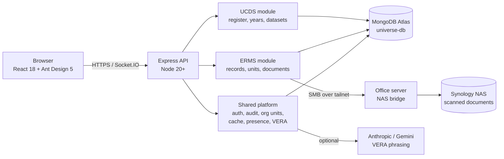

# E-Universe

**Unified Information and Records Management System — DENR Environmental Management Bureau, Region III**

E-Universe brings two systems EMB Region III ran separately into one web application:

- **Universe Central DB (UCDS)** — the Planning Unit's register of establishments, by province and by year: permits, monitoring, legal actions, and the year's other datasets.
- **ERMS** — the electronic records of the **Records**, **Legal Services** and **Laboratory** units: 18,000+ filed records and their scanned documents on the office NAS, replacing the desktop ERMS.

Staff sign in once and see the parts their account is set up for. **VERA**, the built-in assistant, explains how everything works.

> Internal system for official use by EMB Region III. It is deployed on the office network; it is not a public service.

---

## Contents

- [Features](#features)
- [Architecture](#architecture)
- [Repository layout](#repository-layout)
- [Getting started](#getting-started)
- [Configuration](#configuration)
- [Testing](#testing)
- [Operational scripts](#operational-scripts)
- [VERA, the assistant](#vera-the-assistant)
- [Security](#security)
- [Capacity](#capacity)
- [Deployment](#deployment)
- [Working with the database](#working-with-the-database)

---

## Features

**Universe Central DB (Planning)**
- Year containers (2024 Data, 2025 Data, …) with a year picker; locked and hidden years.
- The **Monitoring Plan** per province: the establishment register with its permit, monitoring and legal tabs, edit history, and new IDs assigned per province.
- Data quality on the header bell: establishments missing required details, and ECC/CNC numbers filed on more than one establishment.
- Dashboard: permit monitoring (PTO, WWDP, PCO expiry), the monitoring calendar, bulletin postings.
- Each year's other datasets, plus folders and tables staff add themselves.
- Read-only links to the ERMS records filed against an establishment, opened with the Records Unit's approval.

**ERMS (Records, Legal Services, Laboratory)**
- **Document Library**: search by FSN, permit number, proponent or project title; filters; "needs review".
- **Upload record**: the next FSN is claimed on save; permit numbers checked against the register as you type; scans filed on the NAS in the desktop system's folder layout (province › year range › year › project), with a folder picker.
- **File a document** for Legal (NOV, technical conference, order/resolution, payment, attachments) and Laboratory (test results, COC, draft analysis, memo, receipts, calibration). Forms are defined in configuration and laid out in tabs.
- Autocomplete from values already on file. A known docket fills in its company; a COC number fills in its firm.
- Documents are **view-only** in an in-app PDF viewer. Outside the Records Unit, access is by approval (**Document Requests**).
- Custody tracking that cannot be edited after the fact, archive boxes, sealing and disposal records.
- Per-unit working rules: required fields, duplicate rules, classifications.

**Platform**
- One account model across both domains: role → domains → capabilities → province and year scope.
- Admin Settings: user accounts and approval, sign-in history, organizational units, register configuration, ERMS configuration, storage containers, VERA.
- Per-person appearance: theme, accent, navigation style, density.
- Real-time presence: sign-ins and sign-outs are pushed to open screens.
- One sign-in per browser tab.

---

## Architecture

A **modular monolith**: one API, one single-page app, one database, and two business domains that own their own data.



Rules the code holds to:
- **Write ownership is exclusive.** Only ERMS writes `erms-*`; only UCDS writes `ucds-*`. Each domain reads the other only through that domain's own exported service.
- **Every route carries a server-side guard** (`requireDomain`, `requireRole`, `authenticateSession`). A hidden menu item is never the access control. `npm run audit:routes` fails on any unguarded route not explicitly declared public.
- **Documents stay on the NAS.** Records store paths; the server streams the file and decides who may open it.

**Stack**
| Layer | Technology |
|---|---|
| Front end | React 18, Vite 6, Ant Design 5, TanStack Query, Socket.IO client |
| API | Node.js 20+, Express, express-session (sessions in MongoDB), Socket.IO, Zod validation, helmet, express-rate-limit |
| Data | MongoDB Atlas, native driver (no ODM) |
| Documents | Synology NAS over SMB, reached through the office Windows Server (Tailscale subnet route) |
| Assistant | Anthropic Claude (official `@anthropic-ai/sdk`) or Google Gemini — optional |
| Tests | Vitest + Supertest; Playwright for browser smoke runs and screenshots |

---

## Repository layout

```
front-end/                React SPA
  src/modules/            feature modules: ucds/, erms/, admin/, settings/, storage/, vera/
  src/shared/             cross-cutting UI: session transport, feedback, hooks
  src/components/         app shell: side menu, header, footer, auth pages
server/                   Express API
  modules/ucds, modules/erms   the two domains (routes, controllers, services)
  controllers/, routes/   platform endpoints (auth, users, years, NAS, VERA, …)
  services/               authorization, NAS storage and bridge, presence, VERA
  shared/                 error handling, validation, short-lived cache, route inventory
  scripts/                operations: audits, migration, cutover, load test, backups
  tests/                  integration suite (Vitest + Supertest)
scripts/                  env sync and checks used by the front-end build
```

Not in git, deliberately: `server/.env`, `data/` (source extracts with personal data), `backups/`, `reports/`, `docs/` (internal runbooks).

---

## Getting started

**Prerequisites:** Node.js 20 or later, access to the MongoDB Atlas cluster, and (for documents) the office network or the tailnet. For running the tests you also need a local MongoDB (see [Testing](#testing)).

```bash
git clone https://github.com/fons-sabalbosajr/embr3-ucds.git
cd embr3-ucds

# API
cd server
cp .env.example .env        # then fill it in — see Configuration
npm install
npm run dev                 # http://localhost:8081

# SPA, in another terminal
cd ../front-end
npm install
npm run dev                 # http://localhost:5173 (served on the LAN with --host)
```

`npm run dev` and `npm run build` in `front-end/` first copy the `VITE_*` keys from `server/.env` into `front-end/.env.local` (`scripts/sync-env.js`). Only `VITE_*` keys reach the browser bundle; secrets never do.

Accounts are requested from the sign-in page and approved by an administrator under **Admin Settings › User Accounts**. `npm run seed:test-users` creates the test accounts named in `.env`.

---

## Configuration

Everything is in `server/.env`; **`server/.env.example` documents every key.** The important groups:

| Group | Keys |
|---|---|
| Core | `MONGO_URI`, `PORT`, `SERVER_URL`, `SESSION_SECRET`, `ALLOWED_ORIGINS`, `VITE_API_BASE_URL` |
| Documents (NAS) | `NAS_ROOT` / `NAS_SHARE`, `NAS_USERNAME`, `NAS_DOMAIN`, `NAS_BASE_DIR`, `NAS_LEGACY_PREFIXES`, `NAS_ENABLED`, `CONFIG_ENCRYPTION_KEY` |
| ERMS | `ERMS_MODULE_ENABLED` |
| Mail | `EMAIL_USER`, `EMAIL_PASS` |
| VERA | `AUTOMATION_AGENT_ENABLED`, `ANTHROPIC_*`, `GEMINI_*`, `AUTOMATION_AGENT_USER_LIMIT`, `AUTOMATION_AGENT_DAILY_LIMIT` |
| Tests | `TEST_MONGO_URI`, `TEST_MONGO_DB_NAME` |

Storage containers (one per unit's share) and their credentials can also be managed in the app (Admin Settings › Storage Configuration, developer accounts). Their credentials are stored encrypted with `CONFIG_ENCRYPTION_KEY`.

The server warns loudly at startup about common mistakes: a `Secure` session cookie over plain HTTP, `NAS_BASE_DIR` set to a drive letter, and stray semicolons in `.env`.

---

## Testing

```bash
cd server
npm test
```

The suite is an **integration** suite: it tests province scoping, the domain boundary and year containers against real data. It **never runs against production**. `tests/setup.js` points it at `TEST_MONGO_URI` (a local MongoDB by default) and refuses the production cluster.

```bash
# one-time: a local MongoDB on 127.0.0.1:27017, then copy production's working collections into it
npm run test:db:refresh               # reads production, writes only to the test server
npm run test:db:refresh -- --resume   # after a dropped connection, keeps what is already copied
```

The suite also switches VERA's model off, so tests never spend money on an AI provider.

A few NAS tests need the share to be reachable. While the NAS bridge is offline, they time out; that is the network, not the code.

---

## Operational scripts

Run from `server/`.

| Command | Purpose |
|---|---|
| `npm run audit:routes` | List every route and its guards; non-zero exit on an unguarded route |
| `npm run walkthrough` | Per-role capability matrix against a running server |
| `npm run smoke` | Drive a real browser through every screen per role; screenshots to `reports/screenshots/` |
| `node scripts/load-test.js` | Replay recorded screens for N users against the **test** database (`--users=100 --think=30-60`, `--burst`, `--cost`) |
| `npm run cutover:check` | ERMS cutover readiness gate, including cluster storage headroom |
| `npm run daily-check -- --csv=<export>` | Compare the desktop ERMS export with the web records during the parallel period |
| `npm run reconcile` | Re-run the ERMS migration data gates |
| `npm run nas:coverage` | How many records' documents resolve on the share |
| `node scripts/backup-collections.js` | Back up collections as Extended JSON, verified by read-back and SHA-256 |
| `node scripts/drop-backed-up.js` | Drop only collections a verified backup manifest lists (dry run unless `--apply`) |

---

## VERA, the assistant

**VERA** (Virtual Environmental Response Assistant) is the floating **Ask VERA** button on every screen. It is the same assistant, look and approach as in the EMB Region III DTRMS, with its own E-Universe knowledge.

- **Answers from a built-in help library** about how E-Universe works: where a screen is, how to file a document, what a setting does. With an AI model switched on, the same knowledge is phrased conversationally, with follow-ups.
- **Knowledge follows the account.** Planning accounts get the register articles, the ERMS units get the document articles, administrators get configuration, and developers get internals.
- **No data access.** VERA cannot read any record, establishment, permit or document. Only the question, the recent conversation and the name of the current screen are sent to the model.
- **Guards run on the server before any model is reached.** Secrets, keys and environment values are refused for every role. How the system is built is answered only for developers. Off-topic questions are declined.
- **Sign-in page surface** (off by default). A separate, tiny knowledge base: requesting an account, signing in, resetting a password. It never confirms whether an account exists, refuses every lookup, and is rate limited per address.
- **Keys live only in `server/.env`.** They are never stored in the database or sent to a browser. The master switch is `AUTOMATION_AGENT_ENABLED` (or `VERA_ENABLED`). Without it VERA still works, from the help library, at no cost.
- **Limits:** per person per day and for the whole office per day; a duplicate-submit guard.
- **Questions and answers are never stored.** The activity log keeps metadata only: who, when, which screen, which articles matched, model or library, tokens and time.

Configure it in **Admin Settings › VERA Assistant**: the on/off switch, provider (Anthropic or Gemini), model, limits, welcome messages, the sign-in page surface, **Test connection**, and the **Activity Log**. To extend its knowledge, edit `server/services/vera/knowledge.js`. Put articles in the right tier, because the tier is the access decision. `tests/vera.test.js` covers the guards and retrieval.

---

## Security

- **Sessions:** server-side (MongoDB), one per browser tab. Cookie flags follow the transport (`Secure` only over HTTPS). Unchanged sessions are re-saved at most every 10 minutes.
- **Authorization:** every API route is domain- or role-gated on the server, and the route inventory test makes a missing guard fail the build. Province and year scope are applied inside the services.
- **Sign-in rate limit:** 20 attempts per account per address per 15 minutes, plus a ceiling per address, so an office behind one NAT is not locked out by one person's typos. Password reset never reveals whether an address has an account.
- **Documents** are streamed by the server and opened view-only. Access is by domain, province and approval, and every open or refusal is written to the audit trail.
- **Secrets** live only in `server/.env`. NAS credentials saved in the app are encrypted at rest. VERA's keys are never stored or returned.
- **Audit:** one trail (`app-logs`) across both domains, with a domain field.

---

## Capacity

Tested with `scripts/load-test.js`, replaying the requests real screens make, recorded from the app in a browser, for a mixed office population: Planning, Admin, Records, Legal and Laboratory.

| Scenario | Result |
|---|---|
| 100 users, realistic pace (a screen every 30–60 s) | request p95 **99 ms**; slowest screen p95 0.74 s; ~39 database operations/s; 2.7 Mbit/s |
| 100 users, 5× faster than real use | request p95 138 ms; every screen p95 under 1 s; no errors |
| 150 users, 5× faster than real use | request p95 204 ms; slowest screen p95 1.1 s; no errors |
| 100 people pressing Sign in at the same instant | all signed in; worst 1.26 s |

How it scales: expensive shared reads (dashboards, the register check, permit monitoring, province data, year containers) are computed once per scope and shared briefly (`server/shared/services/shortCache.js`), and cleared by the writes that change them. Polling pauses in hidden tabs. Presence is pushed over Socket.IO, and the libuv thread pool is sized for password checks and NAS file access.

---

## Deployment

E-Universe runs on the **office LAN**. The NAS is reachable only from there, through the office Windows Server, which advertises the NAS into the tailnet.

- **API:** `npm start` in `server/` (`node server.js`), on port 8081 by default.
- **SPA:** `npm run build` in `front-end/` produces `front-end/dist/`. Set `VITE_API_BASE_URL` to the API's address first.
- **NAS bridge:** the office server must be on and signed in to Tailscale. When it is off, a banner says so and documents are unavailable; everything else keeps working.
- Give the server a **stable address** (a DHCP reservation or static IP). The build and the CORS allow-list name it.

---

## Working with the database

`universe-db` sits on a **free-tier MongoDB Atlas cluster (512 MB) shared with other EMB applications.** At the cap Atlas blocks writes for **every** application on the cluster.

- **Never** put copies, staging databases or bulk test data on it. Use a local MongoDB (`TEST_MONGO_URI`).
- `npm run cutover:check` reports the cluster's storage headroom.
- Back up before dropping anything: `backup-collections.js`, then `drop-backed-up.js` against the verified manifest.
- Collection names carry their domain: `ucds-*`, `erms-*`, plus shared platform collections (`users`, `app-config`, `app-logs`, `year-containers`, `org-units`, `sessions`, …).
